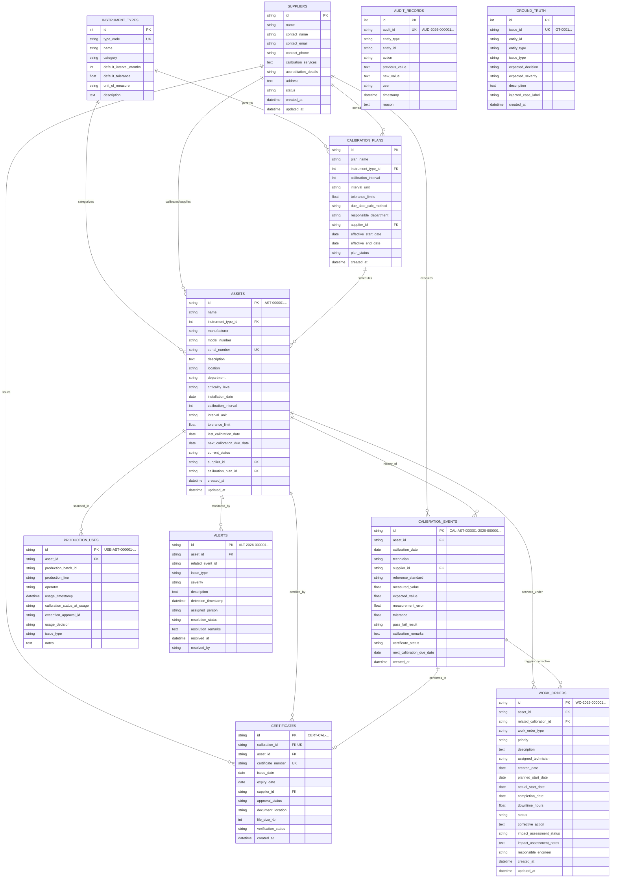

# SmartCal – Entity-Relationship (ER) Diagram

The following diagram illustrates the relational data model of the **SmartCal – Industrial Calibration & Instrument Management System**, showing primary keys, foreign keys, and cardinalities.

