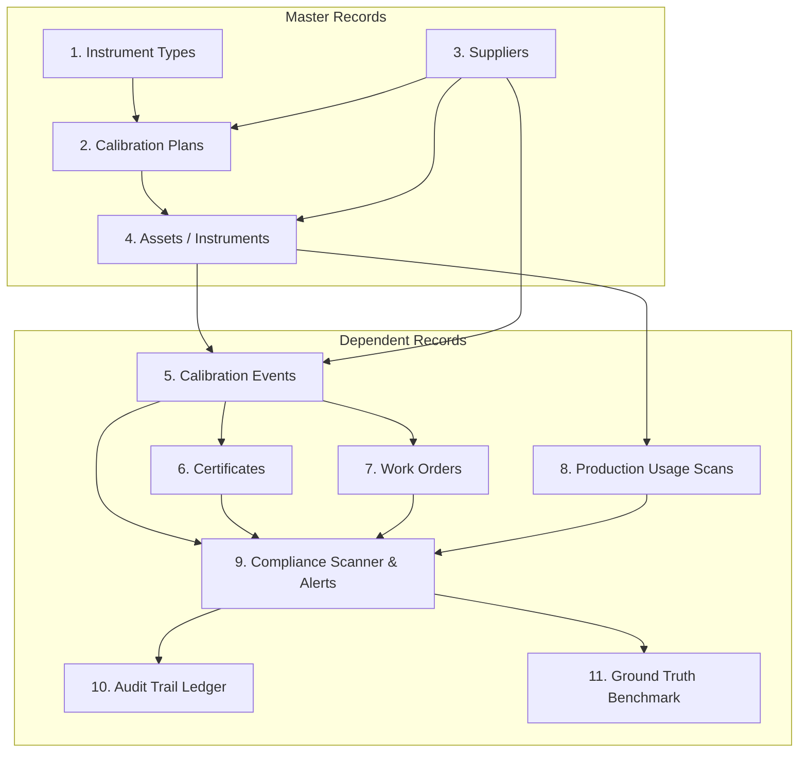

# SmartCal – Synthetic Data Generator Specification & Reference

This document provides a comprehensive technical guide to the **SmartCal Synthetic Data Generation Engine** implemented in [`backend/services/data_generator.py`](file:///c:/CandidateWorkspace/SmartCal%20%E2%80%93%20Industrial%20Calibration%20Management%20System/backend/services/data_generator.py).

---

## 1. Engine Architecture & Determinism

Industrial calibration management systems require realistic test data that accurately mimics high-stakes manufacturing environments (aerospace, automotive, semiconductor, medical devices). The SmartCal synthetic data generator generates enterprise-grade relational datasets with complete referential integrity, physically sound measurements, realistic failure rates, and deterministically injected edge cases for automated evaluation.

### Fixed Pseudo-Random Seeds
To guarantee 100% reproducible datasets across environments, the generator fixes random seeds prior to initialization:
```python
import random
import numpy as np

SEED = 20261022
random.seed(SEED)
np.random.seed(SEED)
```
Every run using the same seed and scale produces identical primary keys, serial numbers, measurement readings, dates, and injected anomaly locations.

---

## 2. Dataset Scales

The data generation engine supports two distinct operating scales:

| Scale Mode | Target Instruments (`assets`) | Target Calibrations (`calibration_events`) | Target Production Uses (`production_uses`) | Typical Certificates | Typical Work Orders | Typical Alerts | Database Flush & Ingestion Time |
| :--- | :--- | :--- | :--- | :--- | :--- | :--- | :--- |
| **`starter`** | 100 | 250 | 5,000 | ~220 | ~20 | ~320 | ~2.5 seconds |
| **`full`** | 2,000 | 5,000 | 100,000 | ~4,500 | ~450 | ~6,500 | ~45 seconds |

The starter dataset is optimized for continuous integration, lightning-fast regression testing, and interactive developer sandboxes. The full dataset is designed for stress testing, database query optimization, and enterprise demonstrations.

---

## 3. Relational Generation Order & Dependency Graph

To guarantee strict foreign key referential integrity without orphan records, records are generated in a strictly ordered dependency pipeline:



### Generation Pipeline Steps:
1. **Instrument Types (Master):** Seeds 6 core metrology taxonomies (`CALIPER`, `MICROMETER`, `PRESSURE_GAUGE`, `TORQUE_WRENCH`, `THERMOCOUPLE`, `MULTIMETER`) with default tolerances (0.01 mm to 1.5 psi) and intervals (3, 6, 12, 24 months).
2. **Suppliers (Master):** Seeds 6 internal and external accredited calibration laboratories (e.g., Mitutoyo Lab Services, Fluke Precision Calibration, Trescal Calibration Services).
3. **Calibration Plans (Master):** Establishes governance rules for each instrument type, linking tolerances, calculation methods (`FIXED_INTERVAL`), and departments.
4. **Assets (Master):** Generates physical assets with unique chassis serial numbers, deterministic IDs (`AST-000001` to `AST-000100`), assigned locations, and commissioning dates over a 1-year timeline (2025-11-01 to 2026-11-12).
5. **Calibration Events:** Generates inspection events. For each event:
   - True reference standard target is selected.
   - Gaussian physical error is sampled: `error = np.random.normal(0, tolerance * 0.5)`.
   - Measured value is derived: `measured_value = round(expected_value + error, 4)`.
   - Pass/fail condition is evaluated: `PASS` if `abs(error) <= tolerance`, else `FAIL`.
   - Pass rate is naturally maintained between 88% and 92%.
6. **Certificates:** For passing calibrations, certificates (`CERT-...`) are issued with valid expiration dates, laboratory accreditation numbers, and SHA-256 digital document hashes.
7. **Work Orders:** Automatically triggered whenever a calibration event records a `FAIL`. Sets priority to `CRITICAL` or `HIGH`, assigns technicians, and initiates required impact assessments.
8. **Production Usage:** High-volume line scanning events (`USE-...`) generated across CNC Milling, Cleanroom, Assembly, and Stamping bays. Validates instrument status at scan time (`ALLOWED` vs `BLOCKED`).
9. **Compliance Scanner & Alerts:** Runs the 9-point rule engine, capturing all overdue instruments, failed events, and missing certificates as active `alerts` (`ALT-...`).
10. **Audit Records:** Writes an immutable audit trail (`AUD-...`) recording every asset creation, status modification, reschedule event, and blocked usage decision.
11. **Ground Truth Benchmark:** Compiles and records injected benchmark defects into `ground_truth` table, `ground_truth.json`, and `ground_truth.csv`.

---

## 4. Deterministic Identifier Schemes

All business entities utilize deterministic, enterprise-style primary keys:

| Entity | Format Regex | Example Identifier |
| :--- | :--- | :--- |
| **Asset** | `^AST-\d{6}$` | `AST-000001`, `AST-000042` |
| **Calibration Event** | `^CAL-AST-\d{6}-\d{4}-\d{6}$` | `CAL-AST-000014-2026-000003` |
| **Certificate** | `^CERT-CAL-AST-.*$` | `CERT-CAL-AST-000014-2026-000003` |
| **Work Order** | `^WO-\d{4}-\d{6}$` | `WO-2026-000001`, `WO-2026-000019` |
| **Production Use** | `^USE-AST-\d{6}-\d{8}T\d{6}$` | `USE-AST-000007-20260415T093214` |
| **Alert** | `^ALT-\d{4}-\d{6}$` | `ALT-2026-000001`, `ALT-2026-000323` |
| **Audit Record** | `^AUD-\d{4}-\d{6}$` | `AUD-2026-000001`, `AUD-2026-000108` |
| **Supplier** | `^SUP-[A-Z0-9-]+$` | `SUP-001`, `SUP-002`, `SUP-INT-001` |
| **Calibration Plan** | `^PLAN-[A-Z0-9-]+$` | `PLAN-CALIPER-001`, `PLAN-TORQUE-001` |

---

## 5. Injected Edge Cases & Anomaly Benchmark Targets

To validate quality compliance logic and audit engines, the synthetic generator intentionally injects **4 documented edge case anomalies** with known ground-truth locations:

### Edge Case 1: `DUE_DATE_MISMATCH`
- **Mechanism:** The stored `next_calibration_due_date` on an asset is deliberately modified to differ from the mathematically calculated date (`last_calibration_date + calibration_interval`).
- **Target Asset:** Typically `AST-000015` or first qualifying calibrated asset.
- **Expected Alert:** `INCORRECT_CALIBRATION_DUE_DATE` (Severity: `HIGH`).
- **Detection Logic:**
  ```python
  expected_due = calculate_next_due_date(asset.last_calibration_date, asset.calibration_interval, asset.interval_unit)
  if asset.next_calibration_due_date != expected_due:
      flag_mismatch(asset.id, asset.next_calibration_due_date, expected_due)
  ```

### Edge Case 2: `EXPIRED_USAGE`
- **Mechanism:** An instrument whose calibration expired is submitted to a production scanning point without a valid waiver or exception approval.
- **Target Usage:** Injected into production usage stream (e.g., `USE-AST-000022-...`).
- **Expected Decision:** `BLOCKED` (Zero-Trust Enforcement).
- **Expected Alert:** `EXPIRED_INSTRUMENT_USAGE` (Severity: `CRITICAL`).
- **Audit Outcome:** Usage attempt is logged to the database as `BLOCKED`, preserving complete operator badge ID and line telemetry.

### Edge Case 3: `CERTIFICATE_ASSET_MISMATCH`
- **Mechanism:** A valid calibration certificate document is generated for calibration event of Asset A, but the certificate's foreign key `asset_id` is intentionally swapped to reference Asset B.
- **Target Record:** `CERT-CAL-AST-...` attached to non-matching asset.
- **Expected Alert:** `CERTIFICATE_ASSET_MISMATCH` (Severity: `CRITICAL`).
- **Detection Logic:**
  ```python
  if certificate.asset_id != calibration_event.asset_id:
      flag_integrity_violation(certificate.id, certificate.asset_id, calibration_event.asset_id)
  ```

### Edge Case 4: `MISSING_IMPACT_ASSESSMENT`
- **Mechanism:** An instrument fails calibration, creating an automated corrective work order. However, the mandatory quality containment impact assessment remains `PENDING` past the allowed turnaround window.
- **Target Record:** `WO-2026-...` for failed calibration event.
- **Expected Alert:** `MISSING_IMPACT_ASSESSMENT` (Severity: `HIGH`).
- **Detection Logic:**
  ```python
  if cal_event.pass_fail_result == 'FAIL':
      if not work_order or work_order.impact_assessment_status == 'PENDING':
          flag_containment_risk(cal_event.id, asset.id)
  ```

---

## 6. Ground Truth Artifacts & Export Formats

Upon completion of dataset generation, the generator exports the exact injected ground-truth metadata to two external files in `backend/`:

### 1. `backend/ground_truth.json`
```json
[
  {
    "edge_case_type": "DUE_DATE_MISMATCH",
    "entity_type": "Asset",
    "entity_id": "AST-000015",
    "expected_alert_type": "INCORRECT_CALIBRATION_DUE_DATE",
    "description": "Calculated next due date (2026-07-15) does not match stored due date (2026-09-15)."
  },
  {
    "edge_case_type": "EXPIRED_USAGE",
    "entity_type": "ProductionUse",
    "entity_id": "USE-AST-000022-20260312T142000",
    "expected_alert_type": "EXPIRED_INSTRUMENT_USAGE",
    "description": "Production usage attempted on expired instrument AST-000022 without approved exception. System decision: BLOCKED."
  },
  {
    "edge_case_type": "CERTIFICATE_ASSET_MISMATCH",
    "entity_type": "Certificate",
    "entity_id": "CERT-CAL-AST-000045-2026-000001",
    "expected_alert_type": "CERTIFICATE_ASSET_MISMATCH",
    "description": "Certificate asset reference AST-000046 does not match calibration event asset reference AST-000045."
  },
  {
    "edge_case_type": "MISSING_IMPACT_ASSESSMENT",
    "entity_type": "CalibrationEvent",
    "entity_id": "CAL-AST-000088-2026-000001",
    "expected_alert_type": "MISSING_IMPACT_ASSESSMENT",
    "description": "Calibration event failed tolerance check but impact assessment remains PENDING on corrective work order."
  }
]
```

### 2. `backend/ground_truth.csv`
Tabular CSV containing headers `edge_case_type`, `entity_type`, `entity_id`, `expected_alert_type`, and `description`.

---

## 7. CLI Execution & API Triggering

### Command-Line Execution
Run directly via the Python CLI:
```bash
# Generate Starter Scale (100 instruments, 250 calibrations, 5000 usages)
python -c "from app import app; from database import db; from services.data_generator import seed_database; app.app_context().push(); seed_database(scale='starter', seed=20261022)"

# Generate Full Scale (2,000 instruments, 5,000 calibrations, 100,000 usages)
python -c "from app import app; from database import db; from services.data_generator import seed_database; app.app_context().push(); seed_database(scale='full', seed=20261022)"
```

### REST API Ingestion Endpoint
Trigger dynamically from the frontend Settings interface:
- **POST** `/api/settings/reseed`
- **Request Body:**
  ```json
  {
    "scale": "starter",
    "seed": 20261022
  }
  ```
- **Response:**
  ```json
  {
    "success": true,
    "message": "Database reseeded successfully",
    "scale": "starter",
    "seed": 20261022,
    "summary": {
      "instruments": 100,
      "calibrations": 250,
      "certificates": 222,
      "work_orders": 21,
      "usages": 5001,
      "alerts": 323,
      "ground_truth_count": 4
    }
  }
  ```
